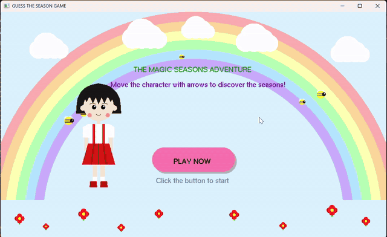

# Guess The Season Game

A small 2D OpenGL game written in C++ (FreeGLUT + GLEW). Explore four seasons
with a character and guess which season each scene shows.

## Gameplay video

[Watch the Full Gameplay](https://youtu.be/6BcqfCzrjPA)

## How to play
- Click **PLAY NOW**, then choose the correct season from the four buttons.
- Wrong answer: try again. Correct answer: move on to the next season.
- Finish all four seasons to reach the trophy screen.

## Controls
| Key | Action |
|---|---|
| Left / Right arrows | Move the character (rotate the trophy on the end screen) |
| Up / Down arrows | Move the character (Spring scene only) |
| `+` / `-` | Zoom in / out |
| Mouse click | Press buttons |

## Requirements
- Windows with Visual Studio (Desktop development with C++)
- Internet connection on first build (NuGet restores FreeGLUT and GLEW automatically)

## Build and run
1. Open the `.sln` file in Visual Studio.
2. Build the project: NuGet restores the `nupengl.core` package (FreeGLUT + GLEW) automatically.
3. Make sure **Working Directory** is `$(ProjectDir)` so the `assets` folder is found.
4. Press **Ctrl+F5**.

## Project structure
- `JoyProject/JoyProject.cpp`: entry point (main, input, timer)
- `JoyProject/src/core`: shapes, textures, audio
- `JoyProject/src/character`: the character
- `JoyProject/src/scenes`: Winter, Spring, Summer, Autumn, Start and End screens
- `JoyProject/src/ui`: buttons and in-game interface
- `JoyProject/assets`: textures and audio
